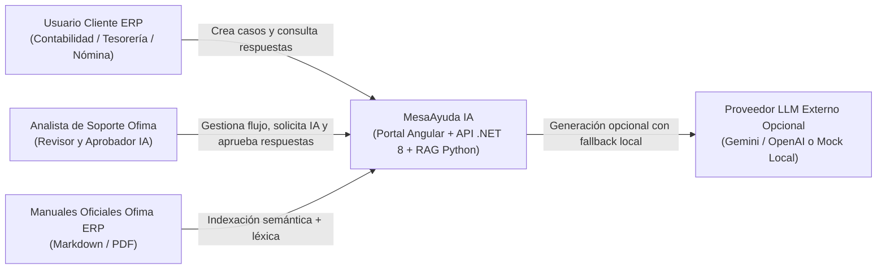
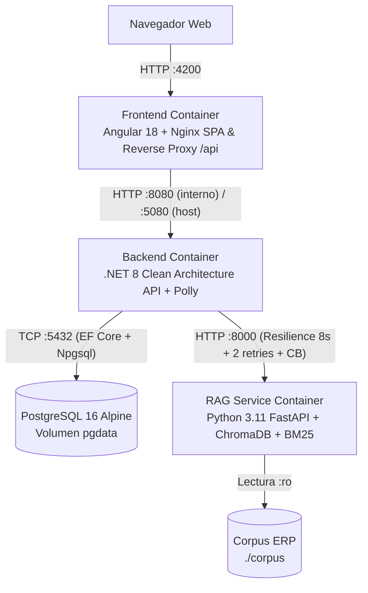
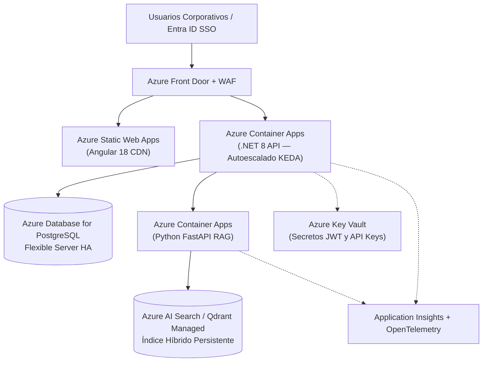

# Arquitectura del Sistema y ADRs — MesaAyuda IA (Ofima S.A.S.)

## 1. Diagramas C4 de Arquitectura

### Nivel 1: Contexto del Sistema

### Nivel 2: Contenedores (Local Docker Compose vs. Producción Azure)

#### Topología Local (`docker-compose.yml` — Red `mesaayuda-net`)

#### Arquitectura Objetivo en Microsoft Azure (Producción)

---

## 2. Architecture Decision Records (ADRs)

### ADR-001: Clean Architecture en .NET 8 + Polly (`Microsoft.Extensions.Http.Resilience`)

- **Contexto:** El núcleo transaccional gestiona autenticación JWT por roles, aislamiento de tickets por cliente, máquina de estados con invariantes estrictas (`Abierto -> EnProceso -> Resuelto -> Cerrado`) e integración síncrona hacia un microservicio externo de IA sujeto a latencia variable.
- **Decisión:** Adoptar **Clean Architecture** en 4 capas (`Domain`, `Application`, `Infrastructure`, `Api`) con entidades ricas (`Caso`, `Respuesta`), `ICasoRepository` + `IUnitOfWork`, FluentValidation, `IExceptionHandler` (`ProblemDetails` RFC 7807) y `Microsoft.Extensions.Http.Resilience` (8s timeout por intento, 2 reintentos exponenciales con jitter y Circuit Breaker).
- **Alternativas descartadas:**
  - *N-capas anémica:* diluye las reglas de transición de estados en controladores o servicios difíciles de probar aisladamente.
  - *Vertical Slice completo con MediatR:* añade indirección innecesaria para el tamaño del MVP de 2 controladores.
- **Consecuencias:** (+) Invariantes de dominio 100% verificables con pruebas unitarias sin base de datos y degradación controlada si cae el RAG. (-) Mayor número de proyectos y mapeos DTO explícitos.

### ADR-002: Microservicio Dedicado en Python 3.11 (FastAPI + ChromaDB + BM25)

- **Contexto:** El ecosistema nativo de embeddings locales (`sentence-transformers`), procesamiento PDF (`pypdf`) y recuperación híbrida (`ChromaDB` + `rank_bm25`) es maduro y eficiente en Python, además de requerir un modo `mock` gratuito y determinista junto con soporte intercambiable para Gemini/OpenAI.
- **Decisión:** Aislar la carga cognitiva en un microservicio Python **FastAPI** independiente con patrón **Strategy** (`LLMProvider`) y búsqueda híbrida (`0.70` coseno + `0.30` BM25Okapi con filtrado de stopwords y caché LRU de embeddings).
- **Alternativas descartadas:**
  - *Semantic Kernel embebido en .NET:* obligaría a depender de endpoints externos para embeddings o a empaquetar runtimes ONNX manuales en el API de negocio, acoplando ciclos de despliegue.
- **Consecuencias:** (+) Escalado independiente en CPU/GPU, iteración rápida del pipeline RAG y evaluación automatizada (`evaluate.py`). (-) Requiere contrato HTTP estable (`SnakeCaseLower`) y resiliencia en la frontera .NET -> Python.

### ADR-003: Chunking Recursivo por Secciones Markdown (`650 / 120`) y Anclaje Estricto (`0.35`)

- **Contexto:** Los manuales ERP combinan pasos operativos numerados, rutas de menú y códigos de error específicos (`FAC-402`, `CON-301`, `INV-108`, `SEC-423`). Fragmentar por longitud fija ciega corta procedimientos y mezcla secciones; responder sin umbral fomenta alucinaciones.
- **Decisión:** Dividir primero por encabezados Markdown (`##` y `###`) omitiendo secciones vacías, y luego aplicar chunking recursivo con `chunk_size=650` y `chunk_overlap=120` preservando `{documento, seccion}` y rechazando consultas con puntaje híbrido inferior a `similarity_threshold=0.35` (`anclado=false`).
- **Alternativas descartadas:**
  - *Chunks grandes (>1500 caracteres):* diluyen la similitud coseno y elevan el consumo de tokens.
  - *Solo búsqueda vectorial sin BM25:* pierde precisión exacta en códigos alfanuméricos como `999905` o `NC-01`.
- **Consecuencias:** (+) Validado empíricamente con **100.00% Retrieval Hit Rate @ 4**, **100.00% Faithfulness** y **100.00% Out-of-Domain Rejection** (`docs/evaluacion-rag.md`). (-) Sensible a cambios de formato si se incorporan documentos sin jerarquía de encabezados.
