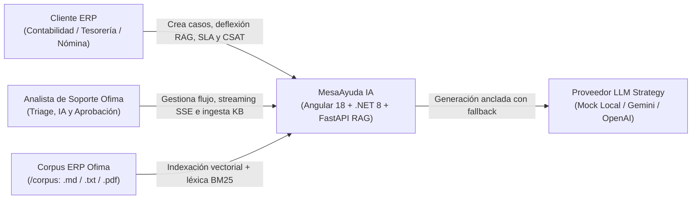
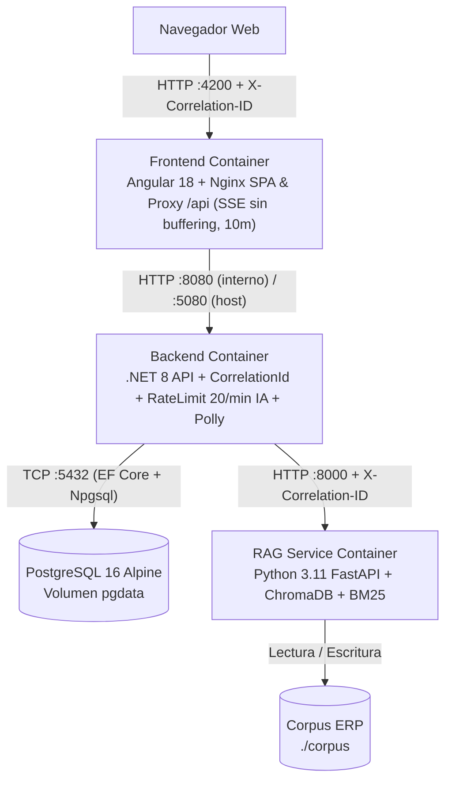
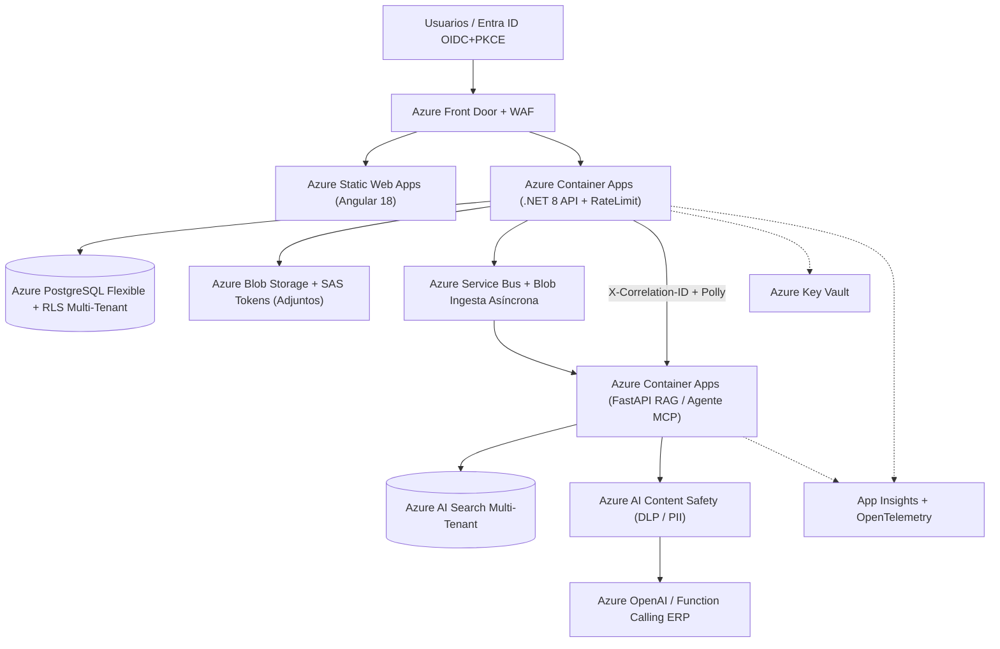

# Arquitectura del Sistema y ADRs — MesaAyuda IA (Ofima S.A.S.)

## 1. Diagramas C4 de Arquitectura

### Nivel 1: Contexto del Sistema

### Nivel 2: Contenedores (Local Docker Compose vs. Producción Azure)

#### Topología Local (`docker-compose.yml` — Red `mesaayuda-net`)

#### Arquitectura Objetivo en Microsoft Azure (Producción Zero-Trust)

**Evolución a producción Azure:** ingesta documental desacoplada vía **Blob Storage + Service Bus**, adjuntos en Blob con **SAS Tokens** efímeros, aislamiento **PostgreSQL RLS + Azure AI Search**, identidad Zero-Trust con **Entra ID + Key Vault + Content Safety (DLP)**, trazabilidad `X-Correlation-ID` y evolución de RAG consultivo a **Agente ERP con Function Calling / MCP**.

---

## 2. Architecture Decision Records (ADRs)

### ADR-001: Clean Architecture en .NET 8 + Polly, Correlación y Rate Limiting FinOps

- **Contexto:** El núcleo transaccional exige RBAC JWT, aislamiento por cliente, máquina de estados, SLA/CSAT, trazabilidad distribuida hacia Python y protección ante abuso o picos de costo IA.
- **Decisión:** Estructurar la solución en 4 capas (`Domain`, `Application`, `Infrastructure`, `Api`) con `CorrelationIdMiddleware` + `CorrelationIdDelegatingHandler` (`X-Correlation-ID` + `ILogger.BeginScope`), **Rate Limiting** nativo (`"AiEndpointsPolicy"`, `20 req/min` con `429 ProblemDetails` sobre endpoints RAG), `ProblemDetails` RFC 7807 y Polly v8 (`15s`, `2` reintentos con jitter y Circuit Breaker).
- **Alternativas descartadas:** *N-capas tradicional* (modelos anémicos) y *gateways externos pesados* en MVP local.
- **Consecuencias:** (+) Trazabilidad punta a punta Angular ➔ .NET ➔ FastAPI y contención inmediata de consumo FinOps sin paquetes externos. (-) Requiere calibrar partición de ventana fija al escalar múltiples réplicas (migrar a Redis Rate Limiting en Azure).

### ADR-002: ChromaDB + Búsqueda Híbrida (`0.70` Vectorial + `0.30` BM25) y Chunking por Secciones (`650 / 120`)

- **Contexto:** Los manuales ERP combinan procedimientos secuenciales con códigos exactos (`FAC-402`, `CON-301`, `INV-108`, `SEC-423`, `999905`). La búsqueda vectorial pura pierde exactitud en códigos alfanuméricos, mientras que el chunking ciego corta pasos operativos.
- **Decisión:** Combinar similitud coseno (`all-MiniLM-L6-v2` en ChromaDB, peso `0.70`) con `BM25Okapi` (peso `0.30`) preservando códigos con guion, tras chunking por encabezados (`##`/`###`) con `chunk_size=650`, `chunk_overlap=120` y `similarity_threshold=0.35`.
- **Alternativas descartadas:** *Solo búsqueda vectorial* (baja precisión en códigos exactos) y *chunks > 1500 caracteres* (dilución semántica y mayor gasto de tokens).
- **Consecuencias:** (+) **100.00%** en Hit Rate @ 4, Faithfulness y rechazo fuera de dominio (`evaluacion-rag.md`). (-) Sensible a documentos sin estructura clara de encabezados.

### ADR-003: Microservicio RAG Desacoplado en Python / FastAPI frente a Semantic Kernel Embebido en .NET

- **Contexto:** La generación de embeddings locales (`sentence-transformers`), lectura PDF (`pypdf`) y evaluación cuantitativa son nativas del ecosistema Python, además de requerir modo `mock` gratuito intercambiable con Gemini/OpenAI.
- **Decisión:** Aislar la recuperación semántica en un servicio **FastAPI** dedicado con patrón **Strategy** (`LLMProvider`) y caché LRU de embeddings, consumido desde .NET detrás de Polly y gateway RBAC (`DocumentosController`).
- **Alternativas descartadas:** *Semantic Kernel embebido en .NET* (acoplaría ciclos de despliegue y exigiría runtimes ONNX manuales o dependencia obligatoria de APIs pagas).
- **Consecuencias:** (+) Escalado independiente en CPU/GPU e ingesta dinámica de manuales sin reiniciar el backend transaccional. (-) Requiere contrato HTTP estable (`SnakeCaseLower`) y timeouts calibrados.
