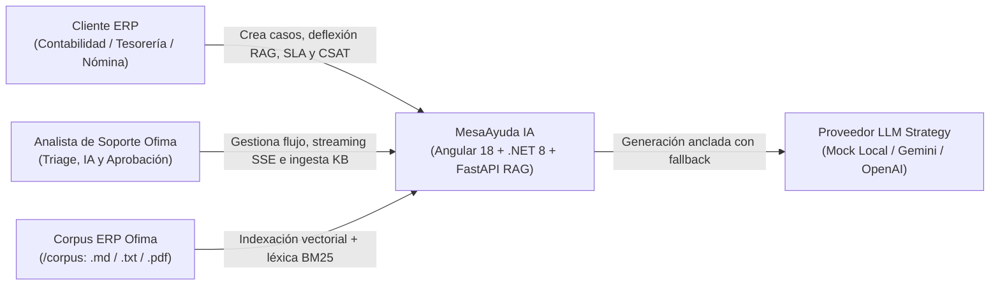
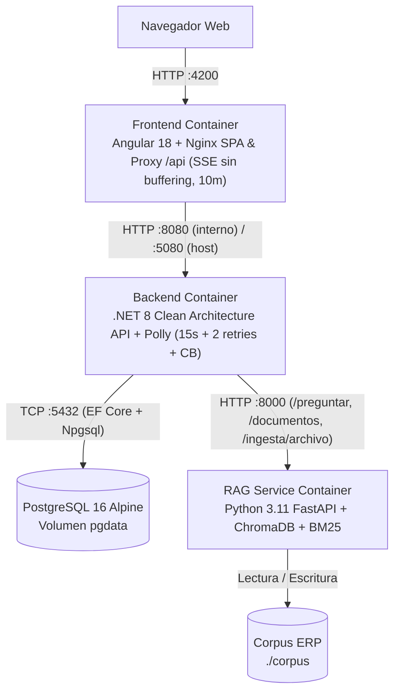
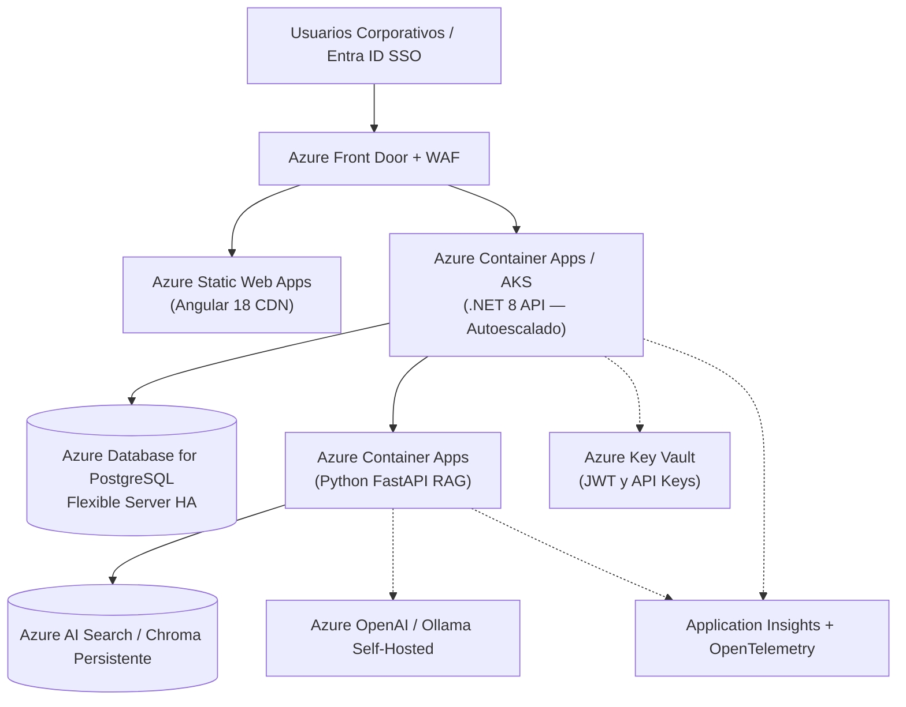

# Arquitectura del Sistema y ADRs — MesaAyuda IA (Ofima S.A.S.)

## 1. Diagramas C4 de Arquitectura

### Nivel 1: Contexto del Sistema

### Nivel 2: Contenedores (Local Docker Compose vs. Producción Azure)

#### Topología Local (`docker-compose.yml` — Red `mesaayuda-net`)

#### Arquitectura Objetivo en Microsoft Azure (Producción)

---

## 2. Architecture Decision Records (ADRs)

### ADR-001: Clean Architecture en .NET 8 + Polly (`Microsoft.Extensions.Http.Resilience`)

- **Contexto:** El núcleo transaccional exige autenticación JWT por roles, aislamiento por cliente, máquina de estados (`Abierto -> EnProceso -> Resuelto -> Cerrado`), reglas SLA/CSAT/papelera y comunicación HTTP con IA sujeta a latencia variable.
- **Decisión:** Estructurar la solución en 4 capas (`Domain`, `Application`, `Infrastructure`, `Api`) con entidades ricas (`Caso`, `Respuesta`), patrones `Repository`, `Unit of Work`, `Dependency Injection`, `Options`, `ProblemDetails` RFC 7807 y resiliencia Polly v8 (`15s` timeout, `2` reintentos exponenciales con jitter y Circuit Breaker).
- **Alternativas descartadas:** *N-capas tradicional* (tiende a modelos anémicos y lógica en controladores) y *Vertical Slice con MediatR* (sobrecoste innecesario para el alcance actual).
- **Consecuencias:** (+) Invariantes verificables en pruebas unitarias sin BD y degradación controlada si cae el RAG. (-) Mayor número de proyectos y mapeos DTO explícitos.

### ADR-002: ChromaDB + Búsqueda Híbrida (`0.70` Vectorial + `0.30` BM25) y Chunking por Secciones (`650 / 120`)

- **Contexto:** Los manuales ERP combinan procedimientos secuenciales con códigos exactos (`FAC-402`, `CON-301`, `INV-108`, `SEC-423`, `999905`). La búsqueda vectorial pura pierde exactitud en códigos alfanuméricos, mientras que el chunking ciego corta pasos operativos.
- **Decisión:** Combinar similitud coseno (`all-MiniLM-L6-v2` en ChromaDB, peso `0.70`) con `BM25Okapi` (peso `0.30`) preservando códigos con guion, tras chunking por encabezados (`##`/`###`) con `chunk_size=650`, `chunk_overlap=120` y `similarity_threshold=0.35`.
- **Alternativas descartadas:** *Solo búsqueda vectorial* (baja precisión en códigos exactos) y *chunks > 1500 caracteres* (dilución semántica y mayor gasto de tokens).
- **Consecuencias:** (+) **100.00%** en Hit Rate @ 4, Faithfulness y rechazo fuera de dominio (`evaluacion-rag.md`). (-) Sensible a documentos sin estructura clara de encabezados.

### ADR-003: Microservicio RAG Desacoplado en Python / FastAPI frente a Semantic Kernel Embebido en .NET

- **Contexto:** La generación de embeddings locales (`sentence-transformers`), lectura PDF (`pypdf`) y evaluación cuantitativa son nativas del ecosistema Python, además de requerir modo `mock` gratuito intercambiable con Gemini/OpenAI.
- **Decisión:** Aislar la recuperación semántica en un servicio **FastAPI** dedicado con patrón **Strategy** (`LLMProvider`) y caché LRU de embeddings, consumido desde .NET detrás de Polly y gateway RBAC (`DocumentosController`).
- **Alternativas descartadas:** *Semantic Kernel embebido en .NET* (acoplaría ciclos de despliegue y exigiría runtimes ONNX manuales o dependencia obligatoria de APIs pagas).
- **Consecuencias:** (+) Escalado independiente en CPU/GPU e ingesta dinámica de manuales sin reiniciar el backend transaccional. (-) Requiere contrato HTTP estable (`SnakeCaseLower`) y timeouts calibrados.
